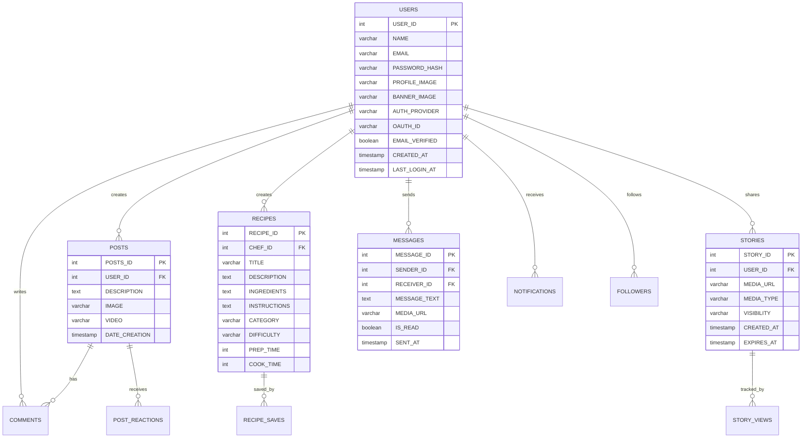

<p align="center">
  
</p>

<h1 align="center">Feedora</h1>

<p align="center">
  <strong>A social platform where food lovers discover, cook, and share recipes together.</strong>
</p>

<p align="center">
  <a href="#-features"></a>
  <a href="#-tech-stack"></a>
  <a href="#-tech-stack"></a>
  <a href="#-tech-stack"></a>
  <a href="#-cloud-services"></a>
  <a href="#-testing"></a>
  <a href="https://github.com/Nitro-Coder-ai/Feedora_V1"></a>
</p>

<p align="center">
  <a href="#-quick-start">Quick Start</a> •
  <a href="#-features">Features</a> •
  <a href="#-architecture">Architecture</a> •
  <a href="#-database-schema">Database</a> •
  <a href="#-api-reference">API</a> •
  <a href="#-testing">Testing</a> •
  <a href="#-contributing">Contributing</a>
</p>

---

## 📖 About

**Feedora** is a full-stack social platform purpose-built for food enthusiasts. Think of it as **Instagram meets AllRecipes** — a space where home cooks, professional chefs, and food lovers come together to share recipes, post culinary creations, go live, chat in real time, and discover new flavors from around the world.

### ✨ What makes Feedora special?

| | |
|---|---|
| 🧑‍🍳 **Built for food creators** | Every feature is designed around the culinary experience — from structured recipe cards to live cooking sessions |
| 💬 **Truly social** | Real-time messaging, stories, reactions, follows, and a community feed keep users engaged |
| 🔒 **Secure by design** | CSRF protection, parameterized queries, OAuth 2.0, email verification, and XSS sanitization |
| ☁️ **Cloud-native media** | All images and videos are served via Cloudinary CDN with automatic format optimization |
| 📱 **Responsive** | Fully responsive UI that works beautifully on desktop, tablet, and mobile |

---

## 🚀 Features

### Core Platform

| Feature | Description |
|---------|-------------|
| 🏠 **Landing Page** | Beautiful public homepage showcasing featured recipes, top chefs, live sessions, and community highlights — converts visitors to users |
| 📰 **Social Feed** | Scroll through posts from the community with images, videos, descriptions, reactions, and comments |
| 📝 **Create Posts** | Share your culinary moments with text, photos, or videos — edit and delete your own posts anytime |
| ❤️ **Reactions & Comments** | React to posts with food-themed reactions (🤤 Yummy, 😋 Delicious, etc.) and leave detailed comments |

### Recipes

| Feature | Description |
|---------|-------------|
| 📖 **Recipe Management** | Create structured recipes with title, description, ingredients, instructions, prep/cook time, and hero images |
| 🏷️ **Categories & Filters** | Browse recipes by category (Appetizers, Main Course, Desserts, Beverages, Salads, Soups, Breakfast, Snacks) and difficulty level |
| 🔍 **Search** | Full-text search across recipes with real-time results via the search API |

### Social

| Feature | Description |
|---------|-------------|
| 📸 **Stories** | Share temporary 24-hour updates with photos/videos — auto-cleanup, view tracking, reactions, and reply support |
| 💬 **Real-Time Chat** | Full messenger system with 1-on-1 conversations, group chats, media sharing, message reactions, read receipts, and online/last-seen indicators |
| 📞 **Voice & Video Calls** | Initiate calls directly from chat — supports multi-party calling with call state management |
| 👤 **User Profiles** | Customizable profiles with avatars, banners, bios, follower/following counts, and a grid of your posts and recipes |
| 🔔 **Notifications** | Real-time alerts for new followers, post reactions, comments, story views, and chat messages |
| 🎥 **Live Cooking** | Host and join live cooking sessions — bringing the community together in real-time |

### User Management

| Feature | Description |
|---------|-------------|
| 🔐 **Secure Authentication** | Traditional email/password with bcrypt hashing, plus Google and Facebook OAuth 2.0 |
| ✉️ **Email Verification** | SMTP-based verification flow with token expiry — dev-mode fallback with on-screen link |
| 🚀 **Onboarding** | Guided new-user experience for profile setup and interest selection |
| ⚙️ **Settings** | Full account management — update profile, change password, manage privacy, delete account |

---

## 🏗️ Architecture

### High-Level Overview

```
                            ┌──────────────────────────┐
                            │        BROWSER           │
                            │  HTML5 / CSS3 / ES6+ JS  │
                            └────────────┬─────────────┘
                                         │  HTTP / AJAX (JSON)
                                         ▼
┌────────────────────────────────────────────────────────────────────┐
│                         APACHE + .htaccess                        │
│              URL rewriting · GZIP · Security headers              │
└────────────────────────────────┬───────────────────────────────────┘
                                 │
                                 ▼
┌────────────────────────────────────────────────────────────────────┐
│                        PHP APPLICATION LAYER                      │
│                                                                   │
│  ┌─────────────┐  ┌─────────────┐  ┌─────────────┐               │
│  │  Routing &  │  │   Session   │  │    CSRF     │               │
│  │  Entry Pts  │  │  Management │  │  Middleware  │               │
│  └──────┬──────┘  └──────┬──────┘  └──────┬──────┘               │
│         └────────────────┼────────────────┘                      │
│                          ▼                                        │
│  ┌────────────────────────────────────────────────────────────┐   │
│  │                    SERVICE MODULES                         │   │
│  │                                                            │   │
│  │  ┌──────────────┐  ┌──────────────┐  ┌──────────────┐     │   │
│  │  │     Auth     │  │   Recipes    │  │  Social Feed │     │   │
│  │  │   Service    │  │   Service    │  │   Service    │     │   │
│  │  │              │  │              │  │              │     │   │
│  │  │ • Login/     │  │ • CRUD ops   │  │ • Post CRUD │     │   │
│  │  │   Register   │  │ • Categories │  │ • Reactions  │     │   │
│  │  │ • OAuth 2.0  │  │ • Difficulty │  │ • Comments  │     │   │
│  │  │   (G + FB)   │  │   filters    │  │ • Feed algo │     │   │
│  │  │ • Email      │  │ • Full-text  │  │ • Media     │     │   │
│  │  │   verify     │  │   search     │  │   uploads   │     │   │
│  │  │ • Password   │  │ • Save/      │  │             │     │   │
│  │  │   hashing    │  │   bookmark   │  │             │     │   │
│  │  └──────────────┘  └──────────────┘  └──────────────┘     │   │
│  │                                                            │   │
│  │  ┌──────────────┐  ┌──────────────┐  ┌──────────────┐     │   │
│  │  │    Chat &    │  │   Stories    │  │ Notification │     │   │
│  │  │  Messenger   │  │   Service    │  │   Service    │     │   │
│  │  │              │  │              │  │              │     │   │
│  │  │ • 1-on-1 DMs │  │ • Create /  │  │ • Event-     │     │   │
│  │  │ • Group chat │  │   view      │  │   driven     │     │   │
│  │  │ • Media      │  │ • 24h auto- │  │   alerts     │     │   │
│  │  │   sharing    │  │   expiry    │  │ • Follows,   │     │   │
│  │  │ • Reactions  │  │ • View      │  │   reactions, │     │   │
│  │  │ • Read       │  │   tracking  │  │   comments,  │     │   │
│  │  │   receipts   │  │ • Reactions │  │   stories    │     │   │
│  │  │ • Presence   │  │   & replies │  │ • Read/      │     │   │
│  │  │   (online/   │  │ • Visibility│  │   unread     │     │   │
│  │  │   last seen) │  │   controls  │  │   state      │     │   │
│  │  │ • Calls      │  │ • Cleanup   │  │              │     │   │
│  │  │   (V&V)      │  │   cron      │  │              │     │   │
│  │  └──────────────┘  └──────────────┘  └──────────────┘     │   │
│  │                                                            │   │
│  │  ┌──────────────┐  ┌──────────────┐  ┌──────────────┐     │   │
│  │  │   Profile    │  │    Media     │  │    Mailer    │     │   │
│  │  │   Service    │  │   Service    │  │   Service    │     │   │
│  │  │              │  │              │  │              │     │   │
│  │  │ • Profile    │  │ • Cloudinary │  │ • Raw SMTP  │     │   │
│  │  │   CRUD       │  │   upload     │  │   client    │     │   │
│  │  │ • Avatar &   │  │ • Auto-      │  │ • Verify    │     │   │
│  │  │   banner     │  │   format     │  │   emails    │     │   │
│  │  │ • Followers  │  │ • Responsive │  │ • Template  │     │   │
│  │  │ • Onboarding │  │   transforms │  │   rendering │     │   │
│  │  │ • Settings   │  │ • Video      │  │ • Multi-    │     │   │
│  │  │              │  │   compress   │  │   provider  │     │   │
│  │  └──────────────┘  └──────────────┘  └──────────────┘     │   │
│  └────────────────────────────────────────────────────────────┘   │
│                          │                                        │
│  ┌───────────────────────┼────────────────────────────────────┐   │
│  │              DATA ACCESS LAYER (PDO)                       │   │
│  │                                                            │   │
│  │  • StoryRepository    • MessageRepository                  │   │
│  │  • CallRepository     • Prepared statements only           │   │
│  │  • Query builders     • Transaction support                │   │
│  └───────────────────────┬────────────────────────────────────┘   │
└──────────────────────────┼────────────────────────────────────────┘
                           │  PDO (mysql)
                           ▼
┌────────────────────────────────────────────────────────────────────┐
│                     MySQL 5.7+  (InnoDB)                          │
│                                                                   │
│  ┌──────────┐ ┌──────────┐ ┌──────────┐ ┌──────────┐             │
│  │  USERS   │ │  POSTS   │ │ RECIPES  │ │ STORIES  │             │
│  └──────────┘ └──────────┘ └──────────┘ └──────────┘             │
│  ┌──────────┐ ┌──────────┐ ┌──────────┐ ┌──────────┐             │
│  │ MESSAGES │ │ COMMENTS │ │FOLLOWERS │ │NOTIFIC.  │             │
│  └──────────┘ └──────────┘ └──────────┘ └──────────┘             │
│  ┌──────────┐ ┌──────────┐ ┌──────────┐ ┌──────────┐             │
│  │  CALLS   │ │ GRP_CHAT │ │REACTIONS │ │  SAVES   │             │
│  └──────────┘ └──────────┘ └──────────┘ └──────────┘             │
│                                                                   │
│  utf8mb4 · Full-Text indexes · Foreign keys · Triggers            │
└────────────────────────────────────────────────────────────────────┘

                           │
              ┌────────────┼────────────────┐
              ▼            ▼                ▼
   ┌──────────────┐ ┌────────────┐ ┌──────────────┐
   │  Cloudinary  │ │   SMTP     │ │   OAuth 2.0  │
   │  (Media CDN) │ │  (Email)   │ │  (Google/FB) │
   │              │ │            │ │              │
   │ • f_auto     │ │ • Gmail    │ │ • Auth code  │
   │ • q_auto     │ │ • Outlook  │ │   flow       │
   │ • w_{size}   │ │ • Brevo    │ │ • Token      │
   │ • destroy()  │ │ • SendGrid │ │   exchange   │
   └──────────────┘ └────────────┘ └──────────────┘
```

### Request Lifecycle

```
 User clicks "Create Post"
        │
        ▼
 ┌─ Browser ─────────────────────────────────────────────────────┐
 │  1. JS validates form (client-side)                           │
 │  2. Builds FormData with CSRF token + media                   │
 │  3. fetch() POST → /dashboard.php?action=create_post          │
 └───────────────────────────────┬───────────────────────────────┘
                                 │
                                 ▼
 ┌─ Server ──────────────────────────────────────────────────────┐
 │  4. Apache routes through .htaccess                           │
 │  5. PHP loads session → verifies CSRF token                   │
 │  6. Validates input (size limits, MIME check, XSS sanitize)   │
 │  7. CloudinaryService::upload() → CDN URL returned            │
 │  8. PDO prepared INSERT into POSTS table                      │
 │  9. notification_utils → fan-out alerts to followers          │
 │ 10. JSON response { success: true, post_id: 42 }             │
 └───────────────────────────────┬───────────────────────────────┘
                                 │
                                 ▼
 ┌─ Browser ─────────────────────────────────────────────────────┐
 │ 11. JS receives response → injects post card into DOM         │
 │ 12. Smooth scroll-reveal animation plays                      │
 └───────────────────────────────────────────────────────────────┘
```

### Tech Stack

| Layer | Technologies |
|-------|-------------|
| **Frontend** | HTML5, CSS3 (custom design system), Vanilla JavaScript (ES6+) |
| **Backend** | PHP 8.x, PDO for database access |
| **Database** | MySQL 5.7+ with InnoDB, utf8mb4 charset (emoji-safe) |
| **Media CDN** | Cloudinary — auto-format, auto-quality, responsive transforms |
| **Authentication** | Session-based + OAuth 2.0 (Google, Facebook) |
| **Email** | Raw SMTP client (no library dependencies) |
| **Testing** | Playwright for end-to-end tests |
| **Build Tools** | esbuild for CSS/JS minification |
| **Typography** | Custom Qurova font family + Google DM Serif Display |

---

## 📂 Project Structure

```
Feedora_Project_Full/
│
├── 📄 Home.php                    # Public landing page
├── 📄 dashboard.php               # Authenticated social feed
├── 📄 recipes.php                 # Recipe browser & creator
├── 📄 view-recipe.php             # Single recipe detail page
├── 📄 chat.php                    # Real-time messaging system
├── 📄 story.php                   # Stories (create & view)
├── 📄 profile.php                 # Initial profile setup
├── 📄 profile_details.php         # Public profile page
├── 📄 profile_settings.php        # Profile editor
├── 📄 settings.php                # Account settings
├── 📄 notifications.php           # Notification center
├── 📄 live.php                    # Live cooking sessions
├── 📄 onboarding.php              # New user onboarding flow
├── 📄 chefs.php                   # Discover & follow chefs
├── 📄 contact.php                 # Contact page
├── 📄 terms.php                   # Terms of service
│
├── 🔐 sign-in.php                 # Login (email + OAuth)
├── 🔐 sign-up.php                 # Registration
├── 🔐 log-out.php                 # Session termination
├── 🔐 verify-email.php            # Email verification handler
├── 🔐 verify-notice.php           # "Check your inbox" page
│
├── 📁 api/
│   └── search.php                 # Full-text search endpoint
│
├── 📁 oauth/
│   ├── google.php                 # Google OAuth callback
│   └── facebook.php               # Facebook OAuth callback
│
├── 📁 config/
│   ├── config.php                 # DB connection (PDO)
│   ├── config.sample.php          # Config template
│   ├── auth.php                   # Auth constants & helpers
│   ├── secrets.php                # 🔒 API keys (git-ignored)
│   └── secrets.sample.php         # Secrets template
│
├── 📁 includes/
│   ├── CloudinaryService.php      # Cloudinary upload/transform
│   ├── StoryService.php           # Story business logic
│   ├── StoryRepository.php        # Story data access
│   ├── StoryFileHandler.php       # Story media processing
│   ├── StoryFactory.php           # Story object creation
│   ├── StoryManager.php           # Story lifecycle management
│   ├── MessageRepository.php      # Chat message data access
│   ├── CallRepository.php         # Voice/video call management
│   ├── Mailer.php                 # SMTP email client
│   ├── messenger.php              # Messenger page renderer
│   ├── recommendations.php        # Content recommendation engine
│   ├── social_login.php           # OAuth login helpers
│   ├── site_header.php            # Shared page header
│   ├── site_footer.php            # Shared page footer
│   ├── preview_community.php      # Public community preview
│   ├── preview_live.php           # Public live preview
│   ├── preview_recipes.php        # Public recipes preview
│   └── story_cleanup.php          # Expired story removal
│
├── 📁 assets/
│   ├── css/                       # Modular CSS (+ .min.css builds)
│   │   ├── dashboard.css
│   │   ├── chat.css / chat-overhaul.css
│   │   ├── messenger.css
│   │   ├── header.css / sidebar.css
│   │   ├── story.css / search.css
│   │   ├── onboarding.css
│   │   └── content-pages.css
│   └── js/                        # Modular JS (+ .min.js builds)
│       ├── dashboard.js
│       ├── chat.js / chat-overhaul.js
│       ├── messenger.js
│       ├── header.js / sidebar.js
│       ├── story.js / search.js
│       └── onboarding.js
│
├── 📁 scripts/
│   ├── 2026_*.sql                 # Database migration scripts
│   ├── build-assets.mjs           # CSS/JS minification build
│   ├── backfill_to_cloudinary.php # Media migration to cloud
│   ├── migrate_static_images.php  # Static asset migration
│   └── ...                        # Other dev/ops utilities
│
├── 📁 tests/                      # Playwright E2E test suite
│   ├── pages/                     # Page Object Models
│   ├── *.spec.ts                  # Test specifications
│   ├── auth.setup.ts              # Auth fixture
│   └── fixtures.ts                # Shared test fixtures
│
├── 📁 docs/
│   └── AUTH_SETUP.md              # OAuth & email setup guide
│
├── 📁 fonts/                      # Custom Qurova font family
├── 📄 Feedora.sql                 # Full database schema
├── 📄 package.json                # Node.js dev dependencies
├── 📄 playwright.config.ts        # E2E test configuration
├── 📄 robots.txt                  # Search engine directives
└── 📄 .htaccess                   # Apache rewrite & security rules
```

---

## 🗄️ Database Schema

The database uses **MySQL 5.7+** with **InnoDB** engine and **utf8mb4** charset for full Unicode and emoji support.



<details>
<summary><b>📋 All database tables (click to expand)</b></summary>

| Table | Purpose |
|-------|---------|
| `USERS` | User accounts, profiles, auth info, Cloudinary IDs |
| `POSTS` | Social feed posts with text and media |
| `RECIPES` | Structured recipe entries with metadata |
| `CATEGORIE` | Recipe categories (Appetizers, Main Course, Desserts, etc.) |
| `COMMENTS` | Post comments |
| `POST_REACTIONS` | Emoji reactions on posts |
| `STORIES` | Ephemeral 24h stories with visibility controls |
| `STORY_VIEWS` | Story view tracking |
| `STORY_REACTIONS` | Reactions and replies to stories |
| `MESSAGES` | Direct messages between users |
| `MESSAGE_REACTIONS` | Reactions on individual messages |
| `GROUP_CHATS` / `GROUP_MEMBERS` / `GROUP_MESSAGES` | Group chat system |
| `CALLS` / `CALL_PARTICIPANTS` | Voice/video call tracking |
| `FOLLOWERS` | User follow relationships |
| `SAVED_RECIPES` | Recipe bookmarks |
| `NOTIFICATIONS` | Activity notifications |
| `USER_INTERESTS` | Onboarding interest selections |
| `POST_MEDIA` | Multi-media post attachments |
| `MUSIC_SHARES` | Music sharing in posts |

</details>

### Migration Scripts

| Script | Purpose |
|--------|---------|
| `2026_schema_optimize.sql` | Core schema optimization (indexes, types) |
| `2026_auth_oauth_email_verify.sql` | OAuth & email verification columns |
| `2026_chat_groups_calls.sql` | Group chat & calling tables |
| `2026_messages_enhancements.sql` | Message reactions, read receipts |
| `2026_messages_read_state.sql` | Read state tracking |
| `2026_multiparty_calls.sql` | Multi-party call support |
| `2026_post_media_music_shares.sql` | Post media & music sharing |
| `2026_story_reactions_replies.sql` | Story reactions & replies |
| `2026_story_visibility_and_onboarding.sql` | Story privacy & onboarding |

---

## 🔌 API Reference

### Search API

```http
GET /api/search.php?q={query}
```

| Parameter | Type | Description |
|-----------|------|-------------|
| `q` | `string` | Search query — searches across recipes, users, and posts |

**Response:** JSON array of search results with matched entities.

### Post Actions (AJAX)

```http
POST /dashboard.php
Content-Type: application/x-www-form-urlencoded

action=edit_post|delete_post
edit_post_id={id}
edit_description={text}
```

### Chat Endpoints

```http
POST /chat.php
Content-Type: application/x-www-form-urlencoded

action=send_message|fetch_messages|get_conversations|mark_read
```

### Story Endpoints

```http
POST /story.php
Content-Type: multipart/form-data

action=create|view|react|reply
```

### User List (Chat)

```http
GET /get_user_list.php?search={query}
```

Returns a filtered list of users for starting new conversations.

---

## 🚀 Quick Start

### Prerequisites

| Requirement | Version | Notes |
|-------------|---------|-------|
| **PHP** | 8.0+ | With PDO MySQL extension |
| **MySQL** | 5.7+ | InnoDB, utf8mb4 support |
| **Web Server** | Apache / Nginx | XAMPP, WAMP, MAMP, or standalone |
| **Node.js** | 18+ | *(Optional)* For building minified assets and running E2E tests |
| **FFmpeg** | Latest | *(Optional)* For video compression on uploads |

### Step 1 — Clone the Repository

```bash
git clone https://github.com/Nitro-Coder-ai/Feedora_V1.git
cd Feedora_V1
```

### Step 2 — Database Setup

```bash
# Log into MySQL and create the database
mysql -u root -p < Feedora.sql
```

This creates the `Feedora` database with all tables, indexes, and seed data.

> **Upgrading an existing database?** Use `scripts/2026_schema_optimize.sql` instead for non-destructive migration.

### Step 3 — Configuration

```bash
# Copy the config template
cp config/config.sample.php config/config.php

# Copy the secrets template
cp config/secrets.sample.php config/secrets.php
```

Edit `config/config.php` with your database credentials:

```php
$db_host = 'localhost';
$db_name = 'Feedora';
$db_user = 'root';
$db_pass = 'your_password';
```

### Step 4 — Launch

**Option A: Using XAMPP/WAMP/MAMP**
```
Place the project folder in your web server's document root
(e.g., htdocs/ for XAMPP) and navigate to:
→ http://localhost/Feedora_V1/Home.php
```

**Option B: PHP Built-in Server**
```bash
php -S localhost:8080
# Open → http://localhost:8080/Home.php
```

### Step 5 — *(Optional)* OAuth & Email Setup

For Google/Facebook login and email verification, see the detailed guide:

📄 **[docs/AUTH_SETUP.md](docs/AUTH_SETUP.md)**

<details>
<summary><b>Quick secrets setup</b></summary>

Edit `config/secrets.php`:

```php
<?php return [
  'GOOGLE_CLIENT_ID'     => 'xxxx.apps.googleusercontent.com',
  'GOOGLE_CLIENT_SECRET' => 'GOCSPX-...',
  'FACEBOOK_APP_ID'      => '...',
  'FACEBOOK_APP_SECRET'  => '...',
  'SMTP_HOST' => 'smtp.gmail.com',
  'SMTP_PORT' => '465',
  'SMTP_SECURE' => 'ssl',
  'SMTP_USER' => 'you@gmail.com',
  'SMTP_PASS' => 'your-app-password',
  'SMTP_FROM' => 'you@gmail.com',
  'SMTP_FROM_NAME' => 'Feedora',
];
```

Or use environment variables prefixed with `FEEDORA_`:

```bash
export FEEDORA_GOOGLE_CLIENT_ID="xxxx.apps.googleusercontent.com"
export FEEDORA_GOOGLE_CLIENT_SECRET="GOCSPX-..."
export FEEDORA_BASE_URL="https://yourdomain.com"
# ... etc
```

</details>

---

## 🧪 Testing

Feedora includes a comprehensive **Playwright** end-to-end test suite.

### Setup

```bash
npm install
npx playwright install
```

### Run Tests

```bash
# Run all tests
npm test

# Run with browser visible
npm run test:headed

# Run with interactive UI
npm run test:ui

# View test report
npm run report
```

### Test Coverage

| Test File | Covers |
|-----------|--------|
| `signin.spec.ts` | Login flow, validation, error handling |
| `signup.spec.ts` | Registration flow, duplicate detection |
| `dashboard.spec.ts` | Feed loading, post display |
| `post.spec.ts` | Post creation |
| `comment.spec.ts` | Comment creation and display |
| `reaction.spec.ts` | Post reactions |
| `stories.spec.ts` | Story creation, viewing, reactions, replies |

---

## 🏗️ Build & Development

### Asset Build Pipeline

CSS and JS files are minified using **esbuild** for production:

```bash
# Build all minified assets
npm run build
```

This processes all files in `assets/css/` and `assets/js/`, generating `.min.css` and `.min.js` counterparts.

### Cloud Media Migration

For migrating local uploads to Cloudinary CDN:

```bash
php scripts/backfill_to_cloudinary.php
php scripts/migrate_static_images.php
php scripts/replace_image_refs.php
```

---

## 🔒 Security

| Feature | Implementation |
|---------|---------------|
| **CSRF Protection** | Token-based verification on all state-changing requests |
| **SQL Injection Prevention** | PDO prepared statements throughout |
| **XSS Sanitization** | `htmlspecialchars()` on all user-generated output |
| **Password Hashing** | bcrypt via `password_hash()` |
| **OAuth 2.0** | Standard authorization code flow (Google, Facebook) |
| **Email Verification** | Time-limited tokens with secure generation |
| **Session Security** | Server-side sessions with regeneration on login |
| **File Upload Validation** | MIME type checking, size limits, secure naming |
| **Access Control** | Route-level authentication checks |

---

## ☁️ Cloud Services

### Cloudinary (Media CDN)

All user-uploaded media is stored and served through **Cloudinary**:

- **Auto-format** (`f_auto`) — serves WebP/AVIF based on browser support
- **Auto-quality** (`q_auto`) — optimizes compression per-image
- **Responsive transforms** (`w_800`, `w_400`) — serves right-sized images
- **Secure deletion** — public IDs tracked for cleanup via `destroy()`

### SMTP Email

Built-in SMTP client (no external library) supports:

| Provider | Host | Port | Encryption |
|----------|------|------|------------|
| Gmail | smtp.gmail.com | 465 | SSL |
| Outlook | smtp.office365.com | 587 | TLS |
| Brevo | smtp-relay.brevo.com | 587 | TLS |
| SendGrid | smtp.sendgrid.net | 587 | TLS |

---

## 🤝 Contributing

1. **Fork** the repository
2. **Create** a feature branch: `git checkout -b feature/amazing-feature`
3. **Commit** your changes: `git commit -m 'feat: add amazing feature'`
4. **Push** to the branch: `git push origin feature/amazing-feature`
5. **Open** a Pull Request

### Commit Convention

| Prefix | Purpose |
|--------|---------|
| `feat:` | New feature |
| `fix:` | Bug fix |
| `docs:` | Documentation changes |
| `style:` | CSS/formatting changes (no logic change) |
| `refactor:` | Code refactoring |
| `test:` | Adding/updating tests |
| `chore:` | Build tools, dependencies, etc. |

---

## 📋 Roadmap

- [x] Core social feed with posts & reactions
- [x] Structured recipe management
- [x] 24-hour ephemeral stories
- [x] Real-time messaging system
- [x] Google & Facebook OAuth
- [x] Email verification flow
- [x] Cloudinary media integration
- [x] Playwright E2E test suite
- [x] Group chat & multi-party calls
- [x] Story reactions & replies
- [x] User onboarding flow
- [ ] WebSocket-based real-time updates
- [ ] Recipe AI recommendations
- [ ] Mobile app (React Native)
- [ ] Advanced analytics dashboard
- [ ] Recipe video tutorials
- [ ] Meal planning & grocery lists

---

## 👥 Team

Built with ❤️ by the **Nitro Coder** team.

---

<p align="center">
  
  
  
  
  
</p>

<p align="center">
  <sub>⭐ Star this repo if Feedora inspires your next food project!</sub>
</p>
